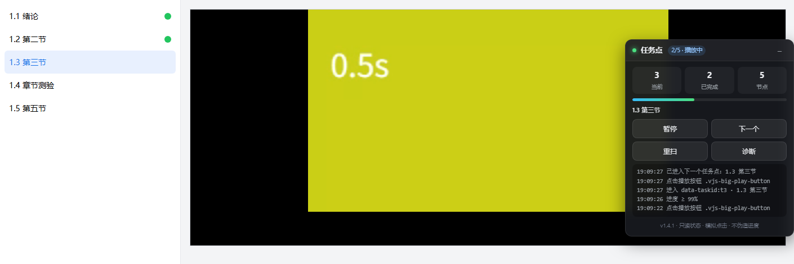

# Chaoxing (Xuexitong) · Auto Next Task Point


A Tampermonkey userscript for Chaoxing / Xuexitong course pages: when the current task point is finished (video ended, progress ≥ 99%, or the platform marks it complete), it **automatically opens the next unfinished task point and starts playback**.

It only reads the page and simulates normal clicks. **No forged progress requests** are sent and the video really plays — including while the tab is in the background or another app is fullscreen.



> Screenshot from a local mock site: task list on the left, player in the middle, floating panel on the right.

---

## Features

| | |
| --- | --- |
| **Advance on completion** | Jumps to the next unfinished point ~1s after the current one is marked done |
| **Advance on end** | `ended` event or progress ≥ 99% counts as finished — no waiting for the platform callback |
| **Force after timeout** | If the platform never writes its state, force-advance after `forceAdvanceMs` (6s by default) |
| **Autoplay with fallback** | Player API → big play button → `play()` → muted playback |
| **Background friendly** | Event-driven (media events + MutationObserver); no reliance on throttled polling timers |
| **Auto resume** | Re-starts playback when the page/site pauses it (tab switch, focus loss, anti-idle). A pause within 1.2s of a real user click is respected |
| **Skip finished** | Finished points are skipped by their DOM markers |
| **Non-video points** | Quizzes and documents are never clicked or answered; skipped with a notice |
| **Floating panel** | Current task, progress, live log, and pause / next / rescan / diagnose buttons |

## Install

1. Install [Tampermonkey](https://www.tampermonkey.net/).
2. Open the install link:
   <https://raw.githubusercontent.com/liangWJ-zip/chaoxing-auto-next/main/chaoxing-auto-next.user.js>
3. Click **Install** on the confirmation page.
4. Tampermonkey checks `@updateURL` for new versions automatically.

> On Edge, the MV3 version of Tampermonkey requires the **Allow User Scripts** switch in `edge://extensions`.

Manual install: Tampermonkey dashboard → *Add new script* → paste [`chaoxing-auto-next.user.js`](./chaoxing-auto-next.user.js) → `Ctrl+S`.

## Usage

The panel appears on the course study page. It can be dragged, collapsed, and remembers its position.

| Button | Action |
| --- | --- |
| Pause / Resume | Toggle the whole automation |
| Next | Jump to the next unfinished point immediately |
| Rescan | Re-scan the task list |
| Diagnose | Print the detected rows and video state to the console |

Console API:

```js
__cxauto.diagnose()
__cxauto.rows()
__cxauto.advance()
__cxauto.set('settleMs', 1000)   // persisted
__cxauto.showPanel() / __cxauto.hidePanel()
```

## How it works

```
video ended / progress ≥ 99% ─┐
task point marked done ────────┼─→ ~1s later → pick next unfinished → click → play
site switches video itself ────┘                    │
                                                    └→ platform never writes state → force after 6s
```

- List changes are observed with `MutationObserver` (120ms debounce)
- Video end is detected with both `ended` and a `timeupdate` ratio check
- One 5s low-frequency safety check is the only polling left

## Configuration

| Key | Default | Description |
| --- | --- | --- |
| `settleMs` | `1000` | Delay before switching after a trigger |
| `forceAdvanceMs` | `6000` | Hard timeout when the platform doesn't mark completion |
| `endProgress` | `0.99` | Progress ratio considered "finished" |
| `autoResume` | `true` | Resume when the page pauses the video |
| `onNonVideo` | `'skip'` | Non-video points: `skip` or `stop` |
| `notify` | `true` | Desktop notification on switch |
| `panel` | `true` | Show the floating panel |

## FAQ

**The panel doesn't show up.** Make sure the page is a course study page (`studentstudy` / `mycourse` in the URL). The catalog loads asynchronously; the script mounts the panel first and retries for up to 3 minutes.

**The video stops when I switch apps.** Check the panel log for `被暂停（…），恢复播放`. If it's missing, the page pauses in a different way — please open an issue with the log.

**No sound after a refresh.** Without a user gesture the browser blocks unmuted autoplay, so the script starts muted. Click anywhere on the page to restore sound.

**Task points aren't detected.** Click *Diagnose* and paste the console table into an issue.

## Boundaries

- No progress/heartbeat requests, no platform data modification
- Quizzes and documents are never answered or clicked
- Stops immediately on captcha / face verification dialogs; no bypass
- For learning browser automation and userscript development only

## Development

The repo includes a local mock site and an end-to-end test driven by a real headless Chrome/Edge:

```bash
node test/e2e.mjs     # 23 assertions
node test/shot.mjs    # regenerate the README screenshot
```

The browser is auto-detected, or set `CX_BROWSER=/path/to/chrome`. CI runs the same command (`.github/workflows/e2e.yml`, manual trigger).

## Changelog

### v1.4.1
- Mount the panel first and retry while the catalog is still loading
- Child frames no longer take over (fixes duplicate panels)
- Panel position is clamped back into the viewport and re-mounted if removed

### v1.4.0
- Resume playback when the page pauses it (tab switch / focus loss / anti-idle)
- Resume on return of visibility or focus
- Backoff retry instead of giving up

### v1.3.0
- Advance on completion / on end / at 99% / force after timeout
- Four-level autoplay fallback
- Floating panel (progress, log, pause, next, rescan, diagnose)

## License

[MIT](./LICENSE)
