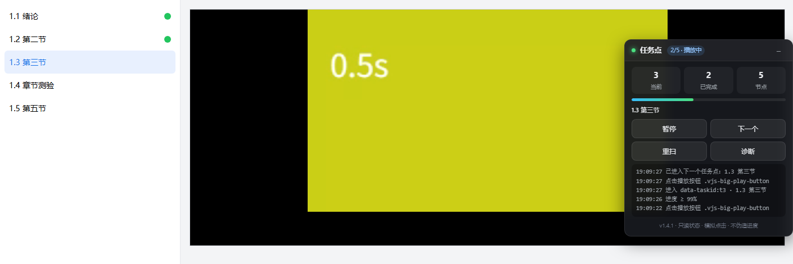

# 超星学习通 · 任务点自动跳转


一个 Tampermonkey 用户脚本：当前任务点的视频播完（或平台标记完成）后，**自动进入下一个未完成任务点并起播播放器**。

只读取页面状态、只模拟正常点击，**不发送任何伪造进度的请求**，视频仍然真实播放。切到别的应用、别的窗口全屏、标签页在后台时同样有效。



> 截图为本地模拟站上的运行效果：左侧任务点列表、中间播放器、右侧悬浮面板（当前任务点 / 完成进度 / 实时日志）。

---

## 功能特性

| 能力 | 说明 |
| --- | --- |
| **完成即跳** | 任务点被标记「已完成」后约 1 秒切到下一个未完成任务点 |
| **结束即跳** | 视频 `ended` 或进度 ≥ 99% 即判定播完，不等平台回调 |
| **超时不卡** | 平台迟迟不写状态时，超过 `forceAdvanceMs`（默认 6 秒）强制推进 |
| **自动播放** | 播放器 API → 大播放按钮 → `play()` → 静音兜底，四级降级 |
| **后台可用** | 推进链路是事件驱动（media 事件 + MutationObserver），不依赖被节流的轮询定时器 |
| **自动恢复** | 被页面暂停（切屏 / 失焦 / 防挂机）时自动拉起；只放过「1.2 秒内你真实点过页面」的主动暂停 |
| **跳过已完成** | 按 DOM 的完成标记跳过已完成节点，不会重复播放 |
| **非视频任务点** | 测验 / 文档不点击、不代答，默认跳过并提示 |
| **悬浮面板** | 当前任务点、完成进度、实时日志，以及 暂停 / 下一个 / 重扫 / 诊断 四个按钮 |

## 安装

### 方式一：从安装链接（推荐）

1. 先安装 [Tampermonkey](https://www.tampermonkey.net/)（Chrome / Edge）
2. 点这里安装：
   <https://raw.githubusercontent.com/liangWJ-zip/chaoxing-auto-next/main/chaoxing-auto-next.user.js>
3. Tampermonkey 会弹出安装页，点「安装」

> Edge 上新版 Tampermonkey（MV3）需要在 `edge://extensions` 里打开 Tampermonkey 的「允许用户脚本」开关，否则脚本无法运行。

### 方式二：手动粘贴

1. 打开 Tampermonkey 面板 → **添加新脚本**
2. 清空编辑器，粘贴 [`chaoxing-auto-next.user.js`](./chaoxing-auto-next.user.js) 全文
3. `Ctrl + S` 保存

## 使用

打开超星课程学习页，右侧（初次为左下角）出现面板即生效。面板可拖动、可收起，位置会被记住。

| 按钮 | 作用 |
| --- | --- |
| 暂停 / 继续 | 开关整个自动跳转逻辑 |
| 下一个 | 立即进入下一个未完成任务点 |
| 重扫 | 重新扫描任务点列表（改版后识别不到时用） |
| 诊断 | 把识别结果、video 状态打印到控制台 |

控制台接口：

```js
__cxauto.diagnose()             // 打印任务点表格与 video 状态
__cxauto.rows()                 // 当前识别到的任务点列表
__cxauto.advance()              // 立即进入下一个未完成
__cxauto.ensurePlay()           // 手动拉起当前视频
__cxauto.showPanel() / __cxauto.hidePanel()
__cxauto.set('settleMs', 1000)  // 改配置（会持久化）
```

## 工作原理

整条链路是事件驱动的，不靠轮询：

```
视频 ended / 进度 ≥ 99% ─┐
任务点被标记「已完成」 ──┼─→ 约 1 秒后 → 挑下一个未完成节点 → 模拟点击 → 起播
站点自己换片 ───────────┘                    │
                                             └→ 平台一直不写状态 → 6 秒后强制推进
```

- 列表变化用 `MutationObserver`（120ms 合并）监听，不扫全表
- 视频结束用 `ended` + `timeupdate`（比例判定）双保险
- 页面里只保留一个 5 秒的低频兜底检查
- 切后台时浏览器会限制定时器，但「正在出声播放」的标签页不受密集限流；即使被暂停，也会在 `pause` 事件里判断是否该恢复

## 配置

所有项都可以在控制台用 `__cxauto.set(键, 值)` 修改并持久化。

| 键 | 默认 | 说明 |
| --- | --- | --- |
| `settleMs` | `1000` | 触发后等多久再切 |
| `forceAdvanceMs` | `6000` | 平台不标记完成时的强制超时 |
| `endProgress` | `0.99` | 进度达到多少算播完 |
| `autoResume` | `true` | 被页面暂停时自动恢复 |
| `onNonVideo` | `'skip'` | 遇到测验/文档：`skip` 跳过并提示，`stop` 原地停住 |
| `notify` | `true` | 切换时发系统通知 |
| `panel` | `true` | 是否显示悬浮面板 |
| `pointSelectors` | 见源码 | 任务点选择器（超星改版时可调整） |

## 常见问题

**面板没出现？**
确认页面是课程学习页（URL 含 `studentstudy` / `mycourse` 等）。超星的目录是异步加载的，脚本会先挂面板再等目录，最多等 3 分钟。

**切到别的应用，视频还是停了？**
先看面板日志有没有「被暂停（…），恢复播放」。如果没有，说明页面用的不是 `pause` 事件，请把日志发到 Issues。

**刷新后没有声音？**
刷新后没有用户手势，浏览器会拦截有声自动播放，脚本按兜底静音起播。在页面任意位置点一下即可恢复声音。

**识别不到任务点 / 已完成数一直是 0？**
点面板的「诊断」，把控制台里的表格贴到 Issues，通常是超星改版导致选择器变化。

## 边界与免责

- 不发送任何进度、心跳请求，不修改平台数据
- 测验、文档类任务点不点击、不代答
- 检测到验证码 / 人脸识别弹窗会立即停止并提示，不做任何绕过
- 仅供学习浏览器自动化与用户脚本开发使用，请遵守所在平台的使用条款

## 开发

仓库自带本地模拟站 + 真实 Edge（headless）的端到端测试，覆盖链式跳转、完成即跳、超时强制、按比例判定、前台/后台暂停恢复、目录异步渲染。

```bash
node test/e2e.mjs     # 23 项断言
node test/shot.mjs    # 重新生成 README 截图
```

> 测试依赖本机 Edge，路径在 `test/e2e.mjs` 顶部可改；首次运行会在 `test/` 下生成一个 4 秒的测试视频。

## 更新日志

### v1.4.1
- 学习页先挂面板、目录异步加载时持续重试，不再直接退出
- 子框架不再重复接管（修复双面板）
- 面板位置越界时自动校正回视口，被页面重渲染弄丢后自动补回

### v1.4.0
- 被页面暂停时自动恢复（切屏 / 失焦 / 防挂机）
- 页面重新可见、窗口重新聚焦时自动接上
- 连续被打断改为退避重试，不再永久放弃

### v1.3.0
- 完成即跳、结束即跳、99% 判定、超时强制推进
- 四级自动播放降级
- 悬浮面板（进度 / 日志 / 暂停 / 下一个 / 重扫 / 诊断）

## License

[MIT](./LICENSE)
